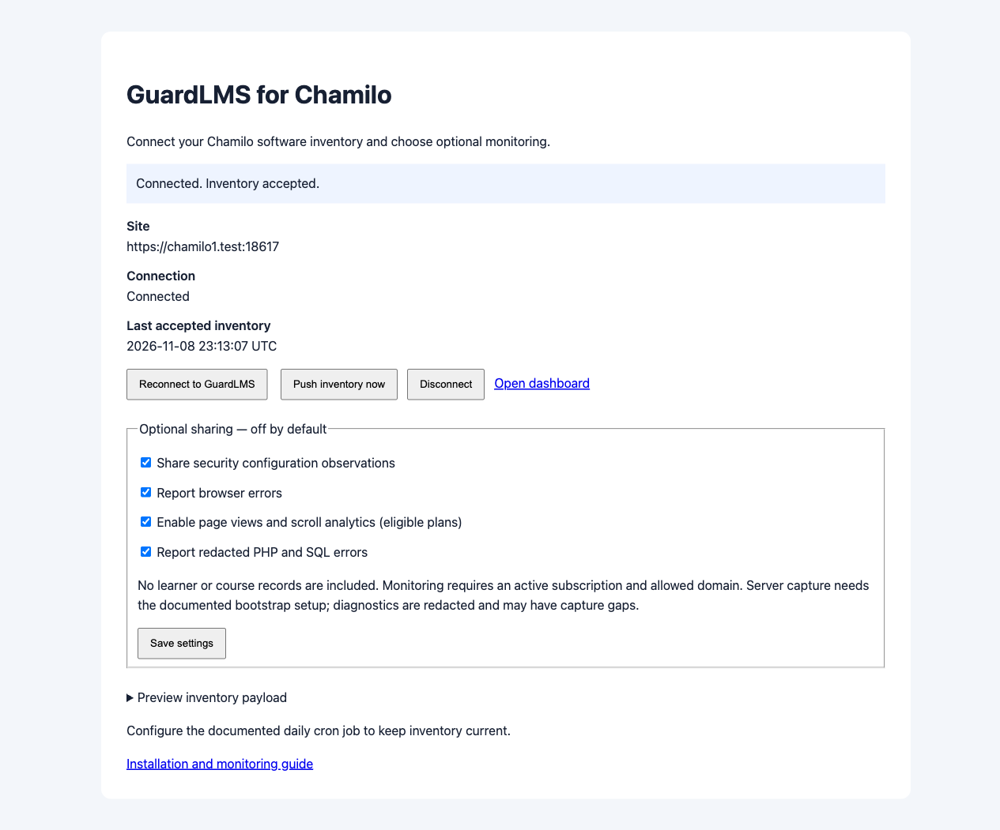

# Chamilo connector: local verification

Verified on 8–9 November 2026 against disposable native installations. This is an **alpha**, with the acceptance limits below; it is not a claim that every deployment topology or capture path is verified. No production deployment or Chamilo core source changes were performed.

Connector: [LdesignMedia/chamilo-guardlms](https://github.com/LdesignMedia/chamilo-guardlms/tree/feature-chamilo-connector). Receiver and reproduction harness are maintained in the private GuardLMS repository. Deploy receiver support before installing on customer sites.

## Exact targets

| Target | Official archive SHA-256 | Observed runtime |
| --- | --- | --- |
| [Chamilo 3.0.2](https://github.com/chamilo/chamilo-lms/releases/tag/v3.0.2) | `c54055f1754b377287c8e73880d2b967128b6d6a86bf3b91262f56cb4df855cf` | PHP 8.3.36; MariaDB 11.4.13; Debian 13; ARM64 |
| [Chamilo 1.11.42](https://github.com/chamilo/chamilo-lms/releases/tag/v1.11.42) | `34dbc5c8d20e151276a751d1d066434828253e7d77cdbc3b0aba7d9865b92401` | PHP 7.4.33; MariaDB 10.11.19; Debian 11; ARM64 |

Both used the official release ZIP including its supplied application/vendor assets, the native web installer and plugin manager, separate databases and encrypted private connector volumes, Apache, and loopback-only HTTPS through nginx. Database/proxy image digests are pinned in Compose. The receiver ran the current GuardLMS code with exact `composer.lock` dependencies, PHP 8.4.27 and a disposable SQLite database. A real GuardLMS account and eligible subscription exercised the actual consent UI and API.

## Runtime checks

| Check | 1.11.42 | 3.0.2 | Evidence or qualification |
| --- | --- | --- | --- |
| Native installation and administrator login | Passed | Passed | Native installer/plugin-manager browser automation |
| Administrator settings, payload preview, manual/initial report | Passed | Passed | Actual inventory persisted; screenshots below |
| Anonymous and student refusal | Passed | Passed | Native student login; plugin settings not exposed |
| Actual GuardLMS sign-in, consent, code exchange, reconnect | Passed | Passed | Browser approval and callback; accepted inventory |
| CSRF and callback state/code replay refusal | Passed | Passed | HTTP 403 on invalid CSRF; consumed callback cannot be reused |
| Ownership meta tag served and parsed | Passed | Passed | Actual anonymous HTTPS HTML; production ownership service persisted html_meta verification with fixture transport pinning |
| Correct native Chamilo/plugin versions and enabled state | Passed | Passed | One installed `guardlms` plugin, version 0.1.0, enabled |
| Native environment and Composer metadata | Passed | Passed | 229 / 340 Composer entries respectively; no npm lockfile in these release installations |
| Plugin pruning, stale snapshot refusal | Passed | Passed | Real receiver requests: add/remove transient plugin; older empty list ignored |
| Scanner refresh retains authenticated rows | Passed | Passed | Real callback service against stored inventory |
| Invalid key and cloned site URL rejected | Passed | Passed | Real HTTPS receiver refusal |
| Untrusted certificate rejected | Passed | Passed | Separate runtime without lab CA; production curl verification enabled |
| Real cron executes due inventory | Passed | Passed | Actual cron daemons; accepted times in `cron-result.json`; daemon output confirmed accepted responses |
| Insecure, incomplete and repaired configuration lifecycle | Passed | Passed | Administrator web requests change `display_errors`, then report partial evidence, then repair; persisted finding checked at each step |
| Browser error and page-view collection | Passed | Passed | Actual SDK HTTP 200 responses and persisted receiver records |
| Scroll collection | Passed | Passed | Persisted depth >=80% tied to the exact SDK session; unload requests need not remain observable by Playwright |
| Chamilo 3 Vue navigation | N/A | Passed | Native router `/home`: same SDK session, exactly one additional page view |
| Single SDK initialization | Passed | Passed | One loader; global init guard; Vue session unchanged |
| Native warning, fatal and SQL failure | Passed | Passed | Controlled administrator-only endpoints; additional persisted native PHP/SQL fingerprints |
| Secret/PII/SQL redaction | Passed | Passed | Queued and persisted events exclude fixture credentials/email/SQL literals; only generic messages and argument-free frames sent |
| Preserve application response and server opt-out | Passed | Passed | Warning response continues; turning server reporting off leaves occurrence count unchanged after another warning |
| Native access-URL selection and isolation | Passed | Passed | Secondary native registry entries; separate settings, plugin enabled state and disconnect; unregistered CLI URL refused |
| Disconnect stops injection; reconnect defaults off | Passed | Passed | Real browser flow and remote disconnect API |

The production middleware/receiver regression tests additionally verify website-bound scopes, wrong-site refusal without freshness changes, revocation, missing/duplicate/oversized inventory, unknown plugin update state, Moodle catalog isolation, stale configuration handling and explicit repair semantics. Connector unit checks exercise state encryption/tamper detection, access-URL storage isolation, expiry, canonical subdirectory callbacks, missing/Composer/npm v1/v2/v3 dependency metadata and reporting overlap locks.

## Regression and package checks

- Focused receiver/consent/scoped-token/SDK authentication: **118 tests, 1,444 assertions passed**.
- Related inventory keys, SDK lifecycle, existing consent, catalog/dependency matching and ownership: **154 tests, 578 assertions passed**.
- Both backend suites reported the repository's **78 existing PHPUnit deprecations**; no test failures.
- Browser SDK: **8 suites, 331 tests passed**, including same-URL Vue history updates, cross-origin credential-free keepalive transport, same-origin beacon authentication and hidden-document scroll delivery.
- Frontend: **48 tests passed** across callback binding, connection UI and bilingual catalog; all three TypeScript configurations passed.
- Connector: **15 checks passed on PHP 7.4 and host PHP 8.4**. All PHP files linted on PHP 7.4 and PHP 8.4. Backend Pint and connector PSR-12 formatting applied; shell syntax and Git whitespace checked.
- ZIP: one top-level `guardlms/` directory; CRCs checked; source, English/Dutch instructions and license included; tests, Git/CI files and credentials excluded. CI builds the same ZIP on PHP 7.4/8.3/8.4.

The shared SDK changes were required by real browser tests: Vue can replace history state without navigating, and cross-origin unload beacons conflict with the collector's deliberate cookie-free CORS policy. The receiver also accepts the existing JSON-body beacon key, with header precedence and malformed-key regression coverage. Built SDK distributions accompany the source.

## Limits and remaining acceptance work

- **Public-network ownership/scanning was not executed end to end.** Production SSRF protection rejects private Docker addresses. The lab-only router supplies validation DNS for exactly two `.test` names and defers public ownership/scanner jobs. Sign-in, approval, code exchange, inventory, monitoring middleware, database writes and processing jobs are real. A separate exact-URL transport fixture exercises the complete production ownership service over actual HTTPS and persists html_meta verification. Production DNS/SSRF enforcement is unchanged. A public staging ownership fetch remains a release gate.
- **Live multi-access-URL topology was not exercised.** Secondary entries created in both real native registries were selected through the new CLI --site option. Settings, plugin enabled state and disconnect stayed isolated, and unregistered URLs were rejected. URL-bound receiver rejection and separate authenticated storage were also verified. A real installation with two independently configured access URLs, administrators and connections remains an acceptance gap. Do not claim that topology verified.
- Password-policy enforcement stays **unknown**: a strength meter does not prove server-side enforcement across native and external authentication paths. The backend supports explicit policy observations, but these adapters omit that verdict. Chamilo 3 exposes native MFA availability/enabling; unavailable legacy MFA evidence remains unknown. No inference of IdP coverage is made.
- Debug output is observed only during web requests. CLI `display_errors` is not evidence of public web output and is deliberately omitted from CLI reports. Missing observations preserve existing findings. CLI/browser PHP settings can differ; test the deployed web runtime.
- Native warnings/fatals and SQL failures were captured with the documented prepend configuration. Errors before the prepend executes, process kills, suppressed/custom diagnostics and external database/proxy errors may be unobservable. Raw diagnostic messages/SQL are intentionally withheld. Native private logs can contain sensitive data and require rotation. Delivery is bounded, best effort and at least once.
- npm parsing was fixture-tested, including nested versions and lockfile v1; these official release installations contained only Composer lock metadata. No live npm installation or frontend build inventory is claimed.
- PHP 7.4 is used solely to verify the requested legacy release compatibility. No other Chamilo releases, operating systems, database engines or PHP combinations are certified by this run.
- The public connector remains alpha until the public ownership and multi-access-URL acceptance gaps are closed. No automatic merge, release publication or production deployment was performed.

## Reproduction and evidence

The private GuardLMS repository contains `integrations/chamilo/docker/README.md` and the reproduction commands; receiver/harness access is required to run the complete lab. Run setup, native install, runtime verification, headed browser verification, web configuration checks, server-error checks, real cron, then focused regressions. Setup rotates disposable keys; do not run it between acceptance phases.

Sanitized evidence:

- [Chamilo 1 runtime/inventory summary](evidence/runtime-1.json), [Chamilo 3 summary](evidence/runtime-3.json).
- [Persisted inventory and scanner preservation](evidence/persisted-inventory.jsonl), [persisted monitoring counts](evidence/persisted-monitoring.jsonl).
- [Chamilo 1 browser result](evidence/browser-result1.json), [Chamilo 3 browser result](evidence/browser-result3.json).
- [Chamilo 1 server/access checks](evidence/server-result1.json), [Chamilo 3 server/access checks](evidence/server-result3.json), [real cron result](evidence/cron-result.json), [native access URL checks](evidence/access-urls.txt).

Private cookies, API/SDK keys, database passwords, callback queries and raw application logs are deliberately absent from committed evidence.
